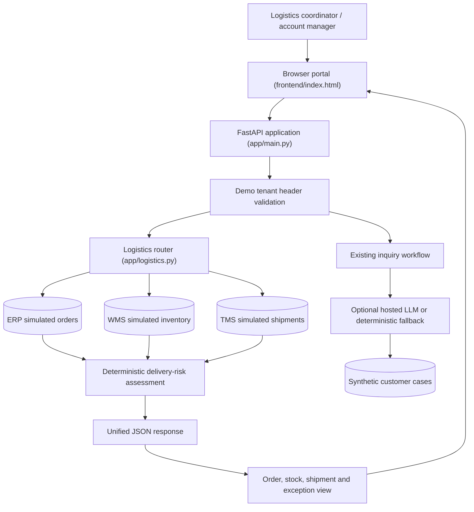
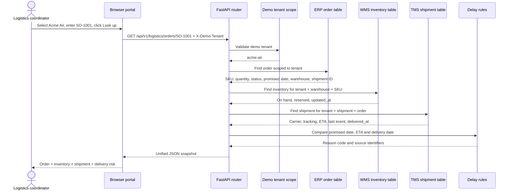

# LSK Customer-Facing FDE — ERP, WMS and TMS Logistics Visibility

> **Status:** Runnable synthetic integration lab on `feature/erp-wms-tms-logistics`. The `production` branch is a demonstration baseline, **not proof of production deployment**. ERP, warehouse, transport, customer, carrier and company records are fictional. No enterprise systems are connected.

## 1. Project overview

This repository demonstrates how a forward deployed engineer can start with a legacy customer-services application, discover a cross-functional logistics problem, integrate read-only source data, deliver a customer-facing proof of concept, and prepare a governed pilot and production handover.

**Business problem:** Logistics and account teams otherwise have to check an ERP for order status, a warehouse management system (WMS) for stock and fulfillment, and a transportation management system (TMS) for shipments. Reconciling those records manually makes it harder to answer customer questions or investigate missed promised dates.

**Delivered in this feature branch:** A FastAPI service joins three independently modeled **synthetic** datasets, computes available stock and delivery-risk flags, and returns one traceable view to the logistics UI. It preserves the existing aerospace repair-order inquiry use case, including an optional AI-generated customer-response draft. AI is not used to invent logistics statuses or make delivery commitments.

**CTO objective:** Demonstrate repeatable, tenant-scoped, read-only logistics visibility and auditable customer inquiry handling before spending on real enterprise integrations. The business outcome to evaluate is quicker, more consistent order and shipment investigations; no time savings have been measured yet.

### Who uses it?

| User | Entry point | What they can do in the demo |
| --- | --- | --- |
| Logistics coordinator | Web portal: Logistics visibility panel | Enter sales order, inspect ERP order, stock and shipment; list delivery exceptions |
| Customer account manager | Web portal: Repair order inquiry | Request a draft customer response grounded in the synthetic repair work order |
| Integration/FDE engineer | OpenAPI docs and curl | Examine API contracts, validate cross-system identifiers, run regression tests |
| Security / operations reviewer | Code, tests and docs | Review tenant scoping, stated limitations and outstanding production controls |

## 2. Architecture and boundaries



**Implementation detail:** ERP, WMS and TMS are represented by separate SQLite tables in one local demo database, not separate running upstream services. The FastAPI router performs parameterized, tenant-filtered reads and combines them in memory. A real deployment would replace this boundary with authenticated ERP/WMS/TMS integration adapters, network and data contracts, and independent system failure handling.

| Component | Code | Responsibility |
| --- | --- | --- |
| Browser UI | `frontend/index.html` | Accept tenant and order input; call logistics/inquiry endpoints; present results |
| Application | `app/main.py` | Serve portal, initialize demo DB, register routes, preserve inquiry API |
| Logistics API | `app/logistics.py` | Read synthetic ERP/WMS/TMS records, aggregate a snapshot, compute late-delivery risk |
| ERP read model | `erp_orders` | Order/customer/SKU/quantity/status/promise date/warehouse/shipment link |
| WMS read model | `wms_inventory` | Tenant/warehouse/SKU/on-hand/reserved stock |
| TMS read model | `tms_shipments` | Carrier/tracking/status/ETA/actual delivery/last event |
| Existing AI response | `app/llm.py` and `app/main.py` | Optional draft response for **repair-order inquiries**, not the logistics risk engine |
| Local deployment | `Dockerfile`, `deploy/compose.yaml` | Reproducible container demo bound to localhost |
| Validation | `tests/`, `.github/workflows/logistics-tests.yml` | API tests and GitHub Actions test job |

## 3. End-to-end: how a user request enters and moves through the system

### Use case A — logistics coordinator investigates an order

**Example:** A coordinator wants to understand why sales order `SO-1001` is at risk of arriving late.



1. **Request creation:** The user opens `/` on the local portal, chooses demo tenant `acme-air`, enters sales order `SO-1001`, then selects **Look up order, inventory and shipment**.
2. **HTTP ingress:** Browser JavaScript calls `GET /api/v1/logistics/orders/SO-1001` with `X-Demo-Tenant: acme-air`. The local Compose port is `127.0.0.1:18641` by default. This is not an enterprise API gateway.
3. **Tenant check:** The router passes the header to the existing demo validator. An absent/unknown tenant returns **401**. This header is **not proof of authenticated user identity** and is unsafe for real customer traffic.
4. **ERP lookup:** A parameterized SQL query selects `erp_orders` by **order_id AND tenant_id**. Unknown or other-tenant orders return **404**.
5. **WMS lookup:** From the ERP result, the service reads inventory matching **tenant_id + warehouse_id + SKU** and calculates `available = max(on_hand - reserved, 0)`. An absent matching stock row is returned as `null`, not fabricated stock.
6. **TMS lookup:** It reads the linked shipment matching **tenant_id + shipment_id + order_id**, retrieving carrier, tracking reference, event, ETA and delivery date. An absent matching shipment is returned as `null` and marked as missing data.
7. **Business rules:** Server-side Python compares the ERP promised date with TMS actual delivery, estimated delivery and the current server date. It emits a machine-readable reason code. No LLM or automatic ERP updates are involved.
8. **Response and display:** The API returns `order`, `inventory`, `shipment`, `late_delivery`, `source_systems`, `as_of_date` and `data_mode: synthetic`; the portal formats the JSON for investigation.

**Concrete seeded scenario:** `SO-1001` has a promised date of **2026-11-10**. Its linked `SHIP-1001` has an ETA of **2026-11-20**, last event **Weather disruption**, and is not delivered. The rule returns `ETA_AFTER_PROMISE`. The matching warehouse has 18 on hand, 5 reserved, **13 available**. This is a synthetic test case, not live carrier data.

### Use case B — investigate all delayed or at-risk shipments

1. The coordinator clicks **Investigate delivery exceptions**.
2. The portal calls `GET /api/v1/logistics/exceptions` with the demo tenant header.
3. The service reads up to **100** tenant-scoped ERP orders, generates each unified snapshot, and retains those with `is_late_or_at_risk=true`.
4. The response contains `count`, `items` and `data_mode`; an optional `limit` parameter between **1 and 100** controls returned items. **Current limitation:** `count` reflects the first 100 scanned orders, not an exhaustive enterprise-wide count.
5. The logistics specialist inspects reason codes and the source last-event data to decide which human-owned follow-up is required. **The application does not create tickets, contact carriers, or change shipment dates.**

**Current deterministic reason codes**

| Reason | Condition |
| --- | --- |
| `SHIPMENT_DATA_MISSING` | No matching tenant-scoped shipment record |
| `DELIVERED_LATE` | Actual delivery date is later than promised date |
| `ETA_AFTER_PROMISE` | Not delivered and estimated delivery is later than promised date |
| `PAST_DUE_NOT_DELIVERED` | Not delivered, and current date is later than promised date |
| `null` | None of the above triggers |

These are **risk indicators**, not a causal diagnosis or a carrier SLA determination. In particular, `ETA_AFTER_PROMISE` has precedence over `PAST_DUE_NOT_DELIVERED` when both apply.

### Use case C — existing repair-order customer inquiry

The original customer workflow remains available. A customer account manager selects a demo tenant, enters a work order such as `WO-1001`, asks a service-status question and clicks **Prepare customer response**.

The portal sends `POST /api/v1/inquiries` with `order_id` and `question`; the server checks tenant ownership, reads the synthetic repair order, builds an evidence-based fallback draft, optionally requests a hosted LLM draft when `OPENAI_API_KEY` is configured, checks whether the query contains commitment-related terms, and stores a draft case. The response includes `case_id`, `source_ids`, `approval_required` and `ai_mode`.

**Approval limitation:** `approval_required` is only a flag. A complete authenticated human-approval workflow is **not implemented**. Do not describe this as an autonomous or approved ERP transaction process.

## 4. API reference

| Method | Endpoint | Input / output |
| --- | --- | --- |
| GET | `/` | HTML demo portal |
| GET | `/health` | Synthetic demo health status |
| GET | `/docs` | FastAPI interactive OpenAPI docs |
| GET | `/api/v1/logistics/orders/{order_id}` | One unified ERP/WMS/TMS snapshot |
| GET | `/api/v1/logistics/inventory/{sku}` | Tenant stock records by SKU |
| GET | `/api/v1/logistics/shipments/{shipment_id}` | One tenant shipment and last known event |
| GET | `/api/v1/logistics/exceptions?limit=50` | First-page scan of tenant delivery risks |
| GET | `/api/v1/orders/{order_id}` | Existing repair-order record |
| POST | `/api/v1/inquiries` | Existing inquiry draft and case ID |
| GET | `/api/v1/cases` | Existing tenant-scoped inquiry cases |

All business data endpoints in the demo require `X-Demo-Tenant: acme-air` or `sky-jet`. The default public portal and `/health` do not. The demo identity header must be replaced before pilot use with real users.

## 5. Run locally

**Prerequisites:** Git and Docker with Compose plugin. Python 3.11+ is useful for running tests outside Docker.

```bash
git clone https://github.com/nolet7/lsk-cusmerfacing-fde.git
cd lsk-cusmerfacing-fde
git switch feature/erp-wms-tms-logistics

docker compose -f deploy/compose.yaml up --build -d
curl -fsS http://127.0.0.1:18641/health
```

Browse `http://127.0.0.1:18641/` for both the repair inquiry demo and the unified logistics panel. Open `http://127.0.0.1:18641/docs` for interactive API documentation.

```bash
# Unified order, stock, shipment and risk
curl -fsS -H 'X-Demo-Tenant: acme-air' \
  http://127.0.0.1:18641/api/v1/logistics/orders/SO-1001

# Warehouse inventory
curl -fsS -H 'X-Demo-Tenant: acme-air' \
  http://127.0.0.1:18641/api/v1/logistics/inventory/TURB-001

# Carrier event and tracking reference
curl -fsS -H 'X-Demo-Tenant: acme-air' \
  http://127.0.0.1:18641/api/v1/logistics/shipments/SHIP-1001

# All flagged orders in the bounded demo scan
curl -fsS -H 'X-Demo-Tenant: acme-air' \
  http://127.0.0.1:18641/api/v1/logistics/exceptions
```

The Compose demo uses a read-only container filesystem with a temporary SQLite database in `/tmp`. Synthetic changes and cases **do not persist across container recreation**. The host port is deliberately bound to loopback. No production database or secret-store integration is set up.

To stop the demo:

```bash
docker compose -f deploy/compose.yaml down
```

## 6. Test and verification

```bash
python -m pip install -r requirements.txt
python -m pytest -q
```

Tests include the legacy inquiry API and logistics visibility, inventory calculation, delivery risk detection, shipment lookups, missing-identity rejection, other-tenant 404 responses, and invalid exception limits. GitHub Actions workflow `.github/workflows/logistics-tests.yml` runs the tests on pull requests.

**Evidence status:** Tests and CI workflow are committed, but a green CI execution, deployed environment and live ERP/WMS/TMS calls have not been confirmed as part of this documentation update.

## 7. Project delivery lifecycle

| Stage | FDE activity | Exit evidence |
| --- | --- | --- |
| Discovery | Interview logistics, supply-chain, account management and integration teams; map existing ERP/WMS/TMS fields | Signed-off use cases, data ownership, permissions and source mapping |
| POC | Seed fictional source data, create API aggregations, show delayed-order investigation | Reproducible local demo, contract tests, demo acceptance |
| Pilot | Replace header identity, integrate one approved test source, add metrics, UAT and failure handling | Security review, integration testing, pilot results and customer signoff |
| Production | Deploy approved infrastructure, real adapters, on-call, SLOs, backups and rollback | Security and operations signoff, live monitoring and release evidence |
| Handover | Runbooks, incident response, ownership, training and feedback backlog | Accepted handover and operational ownership |

### Requirements before real enterprise deployment

- **Real connectors:** Explicit versioned REST/event interfaces to ERP, WMS and TMS with authentication, authorization, timeouts, retry/backoff, circuit breakers, contract testing and reconciliation.
- **Identity:** Enterprise OIDC, verified token signature/audience/issuer/expiry, least-privilege service identity, object-level RBAC/ABAC and audit records. A tenant header supplied by a browser is never a production security boundary.
- **Data correctness:** Managed PostgreSQL and migrations; freshness timestamps and latency budgets by source; explicit stale/partial responses; idempotency, out-of-order events and missing-record handling.
- **Operations:** OpenTelemetry tracing, structured logs, metrics, SLO dashboards, alerting, load testing, backup/restoration drills and rollback rehearsals.
- **Infrastructure:** Versioned IaC for dev/pilot/production, encrypted secrets, private service networking, network policy, image scanning and CI/CD release gates.
- **Business workflow:** Case assignments, verified carrier events, investigated root causes and approval-backed changes to actual business systems.
- **AI safety:** Customer data classification/minimization, grounded source records, prompt/model evaluations and human review for customer commitments.

## 8. Repository map and supporting documents

```text
app/
  main.py                      # Original inquiry API, demo DB setup, router registration
  logistics.py                 # Unified logistics endpoints and risk rules
  llm.py                       # Optional customer-response drafting
frontend/
  index.html                   # Browser portal: customer inquiry + logistics panel
deploy/
  compose.yaml                 # Loopback-bound local synthetic demo
tests/
  test_api.py                  # Existing customer inquiry tests
  test_logistics.py            # Logistics and cross-tenant tests
.github/workflows/
  logistics-tests.yml          # CI regression job
docs/
  LOGISTICS-INTEGRATION.md     # Integration contract, quick demo and rollout gaps
  01-cto-mandate.md            # Business charter
  03-solution-design.md        # Architectural decisions
  07-aerospace-customer-implementation.md
  POC.md / PILOT.md / PRODUCTION.md
architecture/
  *.mmd                        # Existing customer and deployment flow diagrams
```

Additional context: [Logistics integration guide](docs/LOGISTICS-INTEGRATION.md), [CTO mandate](docs/01-cto-mandate.md), [Architecture decisions](docs/03-solution-design.md), [Production readiness checklist](docs/PRODUCTION.md).

## 9. Resume / interview interpretation

**Evidence this project can demonstrate:** Built a tenant-scoped FastAPI demonstration that combines simulated ERP order status, WMS inventory and TMS shipment data; exposes a unified logistics lookup and deterministic late-delivery flags; retains customer-facing AI-assisted inquiry drafting.

**It does not prove:** Real enterprise ERP/WMS/TMS connections, live production availability, measured time saved, actual customer rollout, or enterprise security certification. Distinguish demonstrable code from real work experience when describing the project in an interview.
