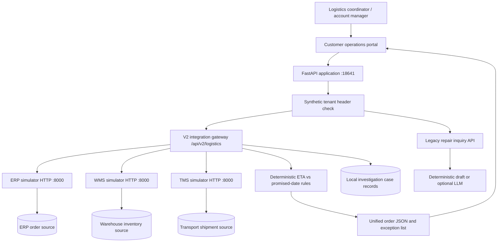
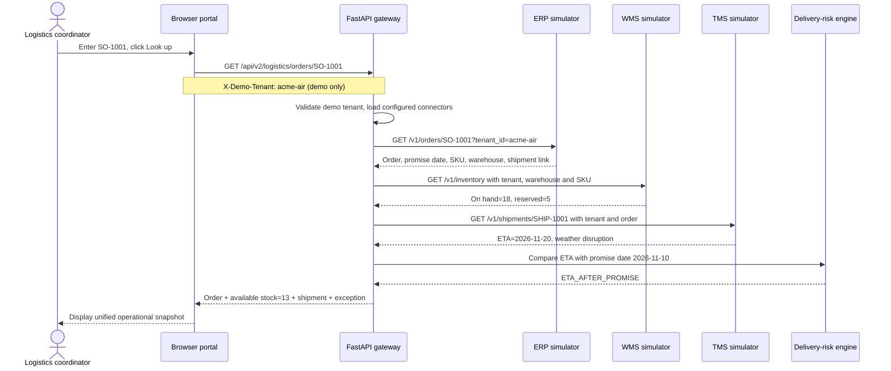

# LSK Enterprise Logistics — Forward Deployed Engineering Engagement

**Customer scenario:** LSK Global Distribution, a fictional multinational B2B distributor.  
**Project:** Customer-specific ERP + WMS + TMS logistics integration and delivery-exception workflow.  
**Status:** Implemented synthetic multi-service POC on `feature/full-fde-logistics-engagement`. **Not a real customer deployment or certified enterprise production environment.**

## CTO mandate

> Our logistics and customer service teams waste time navigating separate ERP, warehouse and transportation applications to answer customer questions. Build a unified customer-facing operations workflow that retrieves trusted order data, stock availability and shipment events, identifies delayed deliveries, and gives employees a way to investigate exceptions without changing the systems of record. Start with a runnable POC, prove it with users, then deliver a secure, supportable enterprise pilot and production release.

See **[Full CTO mandate, stakeholders and phase gates](docs/FDE-CTO-MANDATE.md)** and the **[30-item FDE engineering task list](docs/FDE-TASK-LIST.md)**.

## What makes this an FDE project?

The FDE is accountable for the **customer problem and delivery lifecycle**, not merely writing an API. The intended engagement covers discovery with supply chain, customer success, ERP/WMS/TMS ownership and security; mapping existing source contracts; choosing a safe integration architecture; implementing a demonstrable customer-specific workflow; defining acceptance tests; piloting the solution; and handing it to an operations team. The repository supplies a synthetic implementation and delivery artifacts for this scenario. Real interviews, approvals and production deployment remain future work.

### Business requirements and user personas

| User | Problem | Expected workflow |
| --- | --- | --- |
| Logistics coordinator | Needs one place to investigate a delayed order | Enter sales order, read status + stock + shipment + exception |
| Customer account manager | Needs reliable customer responses | Read repair order details and prepare a sourced response draft |
| Warehouse specialist | Needs accurate available stock | Check on-hand minus reserved quantity |
| Transportation lead | Needs shipment and ETA evidence | Read carrier tracking event, ETA and delay reason |
| FDE / integration engineer | Needs repeatable customer onboarding | Configure source APIs, test contracts and evaluate failed dependencies |
| Security and SRE | Need safe and observable operations | Validate tenant isolation, failures, security gates and runbooks |

## End-to-end architecture



The three source systems run as **independent FastAPI containers** on a private Compose network. They use fictional, in-memory sample records and check a shared demo connector bearer token. The gateway makes actual HTTP calls with a three-second timeout, reads the ERP order first, joins WMS by tenant/warehouse/SKU, joins TMS by tenant/shipment/order IDs, and returns a consolidated response. This is more realistic than joining three tables in one application, but still **not a live SAP/Oracle/warehouse/carrier integration**.

The old `/api/v1/logistics` SQLite demonstration remains available for compatibility. The new user portal uses the networked `/api/v2/logistics` flow.

## How a request moves through the project

### Journey 1: Logistics user checks an order



Detailed steps:

1. **User entry:** A coordinator visits `http://127.0.0.1:18641/`, selects fictional tenant Acme Air and enters `SO-1001`.
2. **Browser request:** The UI sends `GET /api/v2/logistics/orders/SO-1001` with `X-Demo-Tenant: acme-air`.
3. **Gateway validation:** `app/main.py` checks the header against allowed fictional tenants; `app/fde_integration.py` reads configured source base URLs and the internal demo token. No arbitrary caller-supplied URLs are used.
4. **ERP service:** The gateway calls `http://erp:8000/v1/orders/SO-1001` with service authorization and tenant query. ERP returns the order, its promised date, warehouse ID, SKU, quantity, fulfillment status and linked shipment.
5. **WMS service:** The gateway uses the authorized order's warehouse and SKU to query WMS over HTTP. It computes available stock `max(on_hand-reserved,0)`. Unknown stock is shown as missing, not zero.
6. **TMS service:** The gateway queries the exact linked shipment and order for the same tenant, obtaining carrier, tracking number, current shipment state, ETA and last known event.
7. **Business rules:** Deterministic code compares promised date and ETA or actual delivery date. `SO-1001` receives `ETA_AFTER_PROMISE`, with weather disruption recorded as a source event (not independently inferred causation).
8. **User response:** A single JSON representation is displayed in the portal: order, inventory, shipment, delay assessment, source labels and `data_mode=synthetic-http-integration`.
9. **Failure behavior:** Unknown/foreign order returns **404**; missing/unknown demo tenant returns **401**; connector configuration failure returns **503**; upstream HTTP or timeout errors return **502** rather than silently inventing shipment records.

### Journey 2: Investigate and open a case

1. The coordinator selects **Investigate delivery exceptions** in the portal, which calls `GET /api/v2/logistics/exceptions`.
2. The gateway requests an ERP order list and performs an ERP/WMS/TMS lookup per order (bounded to 100 source orders for this POC).
3. Only records with delivery-risk reason codes are returned: `ETA_AFTER_PROMISE`, `PAST_DUE_NOT_DELIVERED`, `DELIVERED_LATE` or `SHIPMENT_DATA_MISSING`.
4. A coordinator enters a note and clicks **Open investigation case**, issuing `POST /api/v2/logistics/investigations`.
5. The server rechecks the order's current simulated delay status. If an exception exists, it persists an `OPEN` investigation record in the local SQLite database and responds with an investigation ID. Otherwise it returns **409**.
6. **Show open investigation history** calls `GET /api/v2/logistics/investigations`, which returns only the chosen demo tenant's records.
7. Cases do **not** notify carriers, write to ERP/WMS/TMS, assign real staff or provide a production-grade approval process. The next pilot phase must add identity, ownership, audit trails, lifecycle states and integrations to an approved ticketing system.

### Journey 3: Existing customer-services AI inquiry

The existing repair-order inquiry remains intact. A user supplies work order `WO-1001` and a question via `POST /api/v1/inquiries`. The service retrieves the tenant-scoped order, creates a deterministic draft or uses an optional configured hosted model, returns source references, flags commitment-sensitive questions and records a case. The AI is **not** used to calculate logistics delivery risk, execute arbitrary SQL or change enterprise transactions. The approval-required flag is not a full human approval workflow.

## API contracts

| API | Endpoint | Purpose |
| --- | --- | --- |
| Gateway | `GET /api/v2/logistics/orders/{order_id}` | Unified networked order lookup |
| Gateway | `GET /api/v2/logistics/exceptions` | Delayed/at-risk order list |
| Gateway | `POST /api/v2/logistics/investigations` | Manual investigation intake |
| Gateway | `GET /api/v2/logistics/investigations` | Tenant's investigation history |
| ERP (private) | `GET /v1/orders` | List tenant orders |
| ERP (private) | `GET /v1/orders/{order_id}` | Lookup tenant order |
| WMS (private) | `GET /v1/inventory` | Filter inventory by tenant, warehouse and SKU |
| TMS (private) | `GET /v1/shipments/{shipment_id}` | Shipment scoped to tenant and order |
| Existing legacy | `GET /api/v1/orders/{order_id}`, `POST /api/v1/inquiries`, `GET /api/v1/cases` | Repair-order inquiry POC |
| General | `GET /health`, `GET /docs` | Health and interactive OpenAPI documentation |

All upstream connector URLs come from environment configuration. The internal bearer token is a **demo-only shared secret**; the caller-selected `X-Demo-Tenant` header is **not secure authentication**. Do not expose the POC to real users or the public Internet.

## Run the integrated four-service demo

Prerequisites: Git, Docker Engine + Compose, Python 3.12+ for host smoke tests.

```bash
git clone https://github.com/nolet7/lsk-cusmerfacing-fde.git
cd lsk-cusmerfacing-fde
git switch feature/full-fde-logistics-engagement

docker compose -f deploy/compose.yaml up --build -d --wait
python scripts/smoke_fde.py
```

Open the **customer operations portal** at `http://127.0.0.1:18641/`. The gateway is exposed on localhost only; the ERP/WMS/TMS service ports are **not published to the host**.

Sample API calls:

```bash
curl -fsS -H 'X-Demo-Tenant: acme-air' \
  http://127.0.0.1:18641/api/v2/logistics/orders/SO-1001

curl -fsS -H 'X-Demo-Tenant: acme-air' \
  http://127.0.0.1:18641/api/v2/logistics/exceptions

curl -fsS -X POST http://127.0.0.1:18641/api/v2/logistics/investigations \
  -H 'X-Demo-Tenant: acme-air' -H 'Content-Type: application/json' \
  -d '{"order_id":"SO-1001","note":"Review TMS disruption and confirm delivery commitment"}'
```

Run regression tests (with Python dependencies installed):

```bash
python -m pip install -r requirements.txt
python -m pytest -q
```

Teardown:

```bash
docker compose -f deploy/compose.yaml down --remove-orphans
```

**Known demo constraints:** Synthetic source records are fixed. The local SQLite investigation store is placed in temporary container storage and is lost after container recreation. The demo connector token has a local default and must never be reused for real deployments. The source list and exception aggregation are intentionally small; there is no event streaming, production pagination, source freshness SLO, retry policy or circuit breaker.

## FDE project stages and task list

| Stage | What FDE delivers | Present state |
| --- | --- | --- |
| 0. Discovery | CTO problem statement, user personas, business requirements, owners and acceptance criteria | Fictional engagement docs prepared; real interviews outstanding |
| 1. Solution architecture | System-of-record mapping, API contracts, ID joins, failure semantics, delivery workflow | Synthetic design implemented |
| 2. POC | Independently running ERP/WMS/TMS simulators, HTTP adapters, unified API, portal and case intake | Code committed; end-to-end validation still to be confirmed |
| 3. Pilot | Real sandbox connections, OIDC/RBAC, audit, Postgres, telemetry and signed UAT | Not implemented |
| 4. Production | GCP IaC, managed secrets/DB, SLA/SLO, load/failover/restore, rollout controls | Not implemented or certified |
| 5. Handover | Customer training, runbooks, escalation, support ownership and feedback loop | Planned |

**Task tracker:** [FDE-TASK-LIST.md](docs/FDE-TASK-LIST.md) lists 30 prioritized tasks, owners, implementation status, acceptance evidence and phase definitions of done. **CTO mandate:** [FDE-CTO-MANDATE.md](docs/FDE-CTO-MANDATE.md) defines outcomes, stakeholders, measures and phase gates.

## Project structure

```text
app/
  main.py                 # FastAPI app, existing customer inquiry, route registration
  logistics.py            # Legacy v1 single-database synthetic logistics integration
  fde_integration.py      # V2 source HTTP orchestration, delay rules, case intake
  llm.py                  # Optional customer inquiry draft inference
services/
  mock_system.py          # ERP/WMS/TMS HTTP service factory selected by SYSTEM_ROLE
frontend/
  index.html              # Logistics and repair-inquiry browser experiences
deploy/
  compose.yaml            # Gateway + three private source containers
scripts/
  smoke_fde.py            # HTTP integration, cross-tenant and case workflow smoke
tests/
  test_api.py             # Existing inquiry regression
  test_logistics.py       # V1 SQL integration regression
.github/workflows/
  logistics-tests.yml     # Existing unit tests
  fde-integration.yml     # Unit tests + four-service Compose smoke
docs/
  FDE-CTO-MANDATE.md      # CTO scenario and phase acceptance
  FDE-TASK-LIST.md        # 30-task prioritized implementation backlog
  LOGISTICS-INTEGRATION.md
  POC.md / PILOT.md / PRODUCTION.md
architecture/
  *.mmd
```

## Production gaps — do not skip

The current state is a **reproducible FDE POC**, not an enterprise production platform. Before claiming deployment to a multinational customer: integrate approved real ERP/WMS/TMS sandboxes; implement actual OIDC/SSO and granular access; rotate secrets in a manager; add production-managed databases, audit and case ownership; enforce allowlisted egress and circuit breakers; verify upstream failure, data freshness and reconciliation; deploy IaC to controlled environments; validate observability, SLOs, security, backup restoration, rollback and signed UAT.

**Resume alignment (simulation):** Developed a customer-facing FastAPI POC that connects independently running simulated ERP, warehouse and transportation services over HTTP, giving logistics users unified order, inventory and shipment visibility and a manual delayed-delivery investigation workflow. **Do not claim it is a live enterprise integration or measured customer impact until that work has been performed and evidenced.**

## Azure enterprise deployment target — 500 named users

The `feature/azure-enterprise-500-users` branch is the **Azure enterprise engineering track** for the existing FDE customer scenario, preserving the functioning local synthetic integration POC while adding Azure deployment artifacts, runtime authorization requirements and shared case persistence.

**Start here:** [Azure 500-user architecture, step-by-step deployment and verification gates](docs/AZURE-ENTERPRISE-500-USERS.md).

### Deployment architecture

- **Compute:** Azure Container Apps gateway with minimum 2 and maximum 12 replicas and HTTP-concurrency autoscaling.
- **Identity:** Microsoft Entra protected API access-token validation, `Logistics.Read` and `Logistics.Write` application roles, and explicitly issued, verified `customer_tenant_id` claim. Browser-supplied demo tenant headers are **blocked** in deployed mode.
- **Data:** Azure Database for PostgreSQL Flexible Server using private VNet integration, a reviewed migration, and a bounded per-replica connection pool. Demo SQLite cases are forbidden in deployed mode.
- **Security:** Azure Key Vault secret references and a user-assigned managed identity; Container Registry access through Azure role assignment. Entra-aware enterprise frontend, perimeter restrictions, and real integration credentials still need customer setup.
- **Platform:** Bicep for networking, private Postgres, ACR, Key Vault, managed identity, Log Analytics and the Azure Container Apps gateway.
- **Testing:** Azure Bicep build, Python regression and security checks, and a k6 workload profile for **500 named users / 50 concurrent active users** as an initial capacity hypothesis.

The enterprise exception-list API is intentionally blocked with HTTP 503 until an indexed, paginated exception read model is added; the current demo N+1 source scan is not safe for production-scale traffic.

The 500-user design is **not yet load-tested or certified**. The current gateway uses synthetic upstream connectors and still requires real ERP/WMS/TMS adapters, a corporate Entra-aware frontend, private network and WAF controls, audited multitenancy, real Azure validation, customer acceptance and production governance. The release gate is explicitly blocked until those requirements are met.

### Azure source files

- [Foundation Bicep](deploy/azure/foundation.bicep)
- [Azure Container Apps Bicep](deploy/azure/aca-gateway.bicep)
- [Enterprise authentication](app/identity.py)
- [PostgreSQL case store](app/case_store.py)
- [Database migration](migrations/001_investigations.sql)
- [500-user capacity scenario](load/azure-500-users.js)
- [Azure deployment guide](docs/AZURE-ENTERPRISE-500-USERS.md)

The original local development workflow remains available via `docker compose -f deploy/compose.yaml up --build -d --wait`.

## Enterprise completion pack (Azure reference branch)

All major remaining enterprise **file sets** have now been added to this branch. Start with the [operations deliverable index](docs/OPERATIONS-DELIVERABLES.md) and [implementation status ledger](docs/IMPLEMENTATION-STATUS.md). This is a file and implementation coverage milestone, **not an assertion that a customer's Azure production platform is already deployed.**

### New end-to-end deliverables

- **Enterprise user entry point:** [Microsoft Entra MSAL SPA](enterprise-ui/README.md), using API access tokens, no demo tenant header, and read/write permissions enforced by the gateway. Client app registrations, trusted customer claim issuance, live sign-in tests, static hosting and approved same-origin routing are required.
- **Scalable exception lookup:** [indexed PostgreSQL read model](app/exception_store.py), [migration](migrations/002_delivery_exceptions.sql), [scheduled refresh script](scripts/refresh_exceptions.py) and [Azure Container Apps job Bicep](deploy/azure/exception-refresh-job.bicep). The enterprise API no longer performs the demo N+1 exception fan-out. Scheduled job execution and source credentials remain unverified.
- **Release lifecycle:** [Azure validation CI](.github/workflows/azure-validation.yml), [approval-gated validation-only release workflow](.github/workflows/azure-release.yml), and [release evidence gates](docs/RELEASE-GATES.md).
- **Operational controls:** [network hardening](docs/NETWORK-SECURITY.md), [security threat model](docs/SECURITY-THREAT-MODEL.md), [database operations](docs/DB-OPERATIONS.md), [SLO plan](docs/OBSERVABILITY-SLOS.md), [incident recovery runbook](docs/RUNBOOK-INCIDENT-RECOVERY.md), and [customer discovery/UAT checklist](docs/CUSTOMER-DISCOVERY-UAT.md).
- **Architecture drawing:** [Azure 500-user architecture](architecture/azure-enterprise-500.mmd).
- **Testing:** [enterprise API tests](tests/test_enterprise_routes.py), [identity tests](tests/test_azure_security.py), [indexed read-model tests](tests/test_exception_store.py), and the existing [500-user population load-test profile](load/azure-500-users.js).

### Production blockers that files alone cannot resolve

1. Actual Azure subscription, identity and private corporate network configuration.
2. Real customer ERP/WMS/TMS API contracts and access, replacing synthetic service credentials.
3. Real Entra application registrations, custom customer-tenant claim validation, enterprise SPA hosting and UAT.
4. Audited PostgreSQL migrations, least-privilege DB roles, tenant RLS policy and production retention/restore evidence.
5. Fully provisioned Front Door Premium/private endpoint/WAF configuration, outbound restrictions, monitoring/alerting and secret rotation.
6. Measured representative 50-active-user and 500-concurrent-user tests; source rate limits, load tuning, failover/rollback.
7. Change-board, security, SRE and customer signoff.

**Current go-live decision: NO-GO** until these external implementation and validation gates pass.
