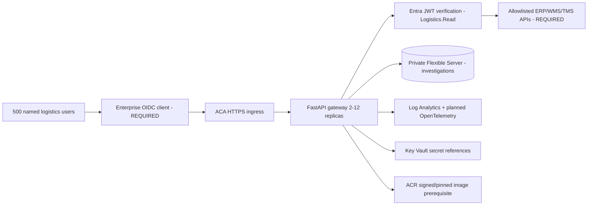

# Azure enterprise deployment — 500-user capacity design and release gates

> **Release state:** Engineering reference and runnable local integration POC. Azure Bicep templates and enterprise API controls are provided, but **no Azure subscription deployment, real ERP/WMS/TMS integrations, Entra customer tenant claim mapping, 500-user benchmark or production signoff has been demonstrated**. Do not deploy synthetic adapters as a real enterprise system.

## 1. Architecture decision (ADR-AZ-001)

Use **Azure Container Apps (ACA), Azure Container Registry (ACR), Microsoft Entra ID, Azure Key Vault, Azure Database for PostgreSQL Flexible Server, Log Analytics and a VNet** for an initial 500-named-user enterprise deployment.

Why ACA rather than AKS for this workload: three external system connectors plus an API gateway do not require customer-managed Kubernetes control-plane operations. KEDA HTTP autoscaling and revision-based deployments are appropriate for a modest HTTP API workload. Revisit AKS only when shared platform policy, mesh, sophisticated workloads or cluster-specific integrations justify added operational complexity.

The supplied Bicep provisions a **private-subnet, zone-redundant PostgreSQL instance** and a scalable ACA gateway. It does not create real ERP/WMS/TMS sources, corporate SSO application registrations, WAF, private ACR/Key Vault endpoints, corporate DNS, audit pipeline, or carrier integrations. Those are explicit go-live blockers.

### Logical request flow



**Security boundary:** The legacy `X-Demo-Tenant` header is rejected in Azure mode. Entra access tokens must have valid issuer, signature, expiry and audience; role `Logistics.Read` for GET and `Logistics.Write` for investigation POST; and a *trusted issued* `customer_tenant_id` claim. The claim is **not a standard Entra claim**, so an approved claims-mapping policy or trusted API token exchange is a prerequisite. The old v1 customer portal/inquiry routes are disabled in deployed mode. A real Entra-aware SPA or internal client application must be supplied before end-user rollout.

**Identity details:** Entra app registration for the **protected API** must expose legitimate application roles `Logistics.Read` and `Logistics.Write`, assign it to approved users/groups, and issue access tokens to the correct API audience. Test role revocation, tenant spoofing, cross-customer access, token expiration, JWKS refresh, key rotation, malformed tokens and delegated vs application permissions before UAT. Do not use ID tokens as API access tokens.

## 2. Sizing assumption — 500 users does not mean 500 simultaneous requests

| Parameter | Initial hypothesis (to be load-tested) |
| --- | --- |
| Named enterprise users | 500 |
| Concurrent active users at normal peak | 10% = 50 |
| Active-user lookup frequency | Approximately 3 lookups/minute |
| Normal peak read throughput | 50 × 3 / 60 = **2.5 RPS** |
| Burst safety planning (10×) | **25 RPS**, before retries/background jobs |
| Gateway configuration | **2 minimum**, **12 maximum** ACA replicas, 1 vCPU/2 GiB each |
| HTTP autoscaling signal | 20 concurrent HTTP requests per replica |
| DB case connection pool | Maximum 5 per API replica, up to 60 pooled connections at 12 replicas |
| PostgreSQL starting profile | General Purpose, 4 vCPU, 128 GiB, zone-redundant HA, private VNet |
| Proposed API SLO (not achieved) | >=99.9% availability per month; p95 read <1.5 sec at agreed load |
| Upstream timeout | 3 sec per HTTP request; ERP read followed by concurrent WMS/TMS reads can still exceed p95 target |
| Load-test stages | 10 -> 50 active VUs, sustained 5 min, gradual ramp-down |
| Stretch test | 500 concurrent authenticated VUs, separately authorized; revise scaling from results |

These are **planning parameters**, not evidence of capacity. The current order lookup retrieves ERP first, then executes independent WMS and TMS reads concurrently. **The enterprise exception-list endpoint deliberately returns 503** until a paginated, indexed, freshness-aware exception read model is implemented; the old demo fan-out across up to 100 orders is not safe for a 500-user rollout. At high latency, external ERP/WMS/TMS connectors—not the ACA replica count—may be the primary bottleneck. Capture true upstream p95 latency, error rates, API limits and data freshness obligations before final sizing.

Load profile: `load/azure-500-users.js`, using k6 with a valid sandbox Entra access token. Its threshold is <1% HTTP failures and p95 under 1500 ms; the script's 50-VU ramp validates a **500-person population assumption** and is not itself a 500-concurrent-user certification.

## 3. Files and deployment boundaries

| File | Purpose |
| --- | --- |
| `deploy/azure/foundation.bicep` | VNet, delegated ACA/PostgreSQL subnets, private DNS, PG Flexible Server, ACR, Key Vault, user-assigned identity, scope RBAC |
| `deploy/azure/aca-gateway.bicep` | Managed ACA environment, HTTPS gateway, min/max replicas, HTTP scale rule, secret references, monitoring |
| `app/identity.py` | Entra JWT verification and fail-closed customer identity scope |
| `app/case_store.py` | Pooled persistent PostgreSQL investigations instead of per-replica SQLite |
| `migrations/001_investigations.sql` | Reviewed migration to run from private connectivity |
| `load/azure-500-users.js` | Synthetic named-user capacity profile |
| `.github/workflows/azure-validation.yml` | Bicep build and Python regression checks |

No IaC file creates GitHub environments, application registrations, protected secrets or source-system connectivity. These must be established by the organization's cloud and identity owners.

## 4. Step-by-step deployment runbook (sandbox first)

### Step A: Prerequisites and approvals

- Approved Azure subscription with Contributor/role assignment privileges for the deployer; organization-specific networking/Key Vault policy and quotas.
- Azure CLI and Bicep, Docker and/or `az acr build`, PostgreSQL client, k6.
- Azure region checked for PostgreSQL ZoneRedundant HA support and ACA subnet availability; validate quotas and SKU availability.
- Registered resource providers: `Microsoft.App`, `Microsoft.ContainerRegistry`, `Microsoft.DBforPostgreSQL`, `Microsoft.KeyVault`, `Microsoft.ManagedIdentity`, `Microsoft.Network`, `Microsoft.OperationalInsights`.
- A documented network path to **real** ERP/WMS/TMS sandbox endpoints (VPN/ExpressRoute/private link as required).
- Entra protected API app registration, approved audience and custom claim issuance; test users/groups.
- IAM/secret-owner approval. ACR/Key Vault **public network access is enabled by the bootstrap template**, so enterprise restrictions/private endpoints and policy controls must be added and reviewed before production.

### Step B: Create an isolated sandbox resource group

```bash
az login
az account set --subscription "<AZURE_SUBSCRIPTION_ID>"
az group create --name "<SANDBOX_RESOURCE_GROUP>" --location "<APPROVED_AZURE_REGION>"
az bicep build --file deploy/azure/foundation.bicep
az bicep build --file deploy/azure/aca-gateway.bicep
```

Replace every placeholder with an approved organization-owned value. No credentials belong in the repository.

### Step C: Deploy the foundation

```bash
az deployment group create \
  --resource-group "<SANDBOX_RESOURCE_GROUP>" \
  --template-file deploy/azure/foundation.bicep \
  --parameters prefix="<UNIQUE_PREFIX>" \
  --parameters postgresAdminPassword="<SECRET_PROVIDED_SECURELY>"
```

**Secret-handling caveat:** Do not paste production passwords literally into command history. In real automation, use a protected secret store and short-lived federated CI identity; pass sensitive values through protected pipeline parameters and ensure deployment logs are restricted. The above illustrates parameter names only.

Review the deployment outputs for `acaSubnetId`, `registryLoginServer`, `identityId`, `vaultName` and `postgresHost`. Private Postgres access requires a VNet-connected deployment runner or a customer-approved access path.

### Step D: Initialize the application database privately

From a VNet-attached migration runner, create a dedicated database and a runtime role, apply `migrations/001_investigations.sql`, and grant only required `SELECT`/`INSERT`/sequence privileges to the runtime role. Do not use the PG administrator account as the application identity. Implement DB-level row-level isolation before regulated multi-tenant operations.

Construct a TLS-verified PostgreSQL connection URL **for the least-privilege role**, stored in Key Vault as a secret, together with the ERP/WMS/TMS outbound connector token. Prefer Entra-based PostgreSQL auth if approved by the organization; this template currently uses a connector string secret.

### Step E: Build and publish an immutable image

```bash
az acr build --registry "<ACR_NAME>" \
  --image "lsk-fde-gateway:<RELEASE_VERSION>" \
  --file Dockerfile .
```

Retrieve the pushed manifest digest using the approved ACR tooling and record the resulting full `<registry>.azurecr.io/lsk-fde-gateway@sha256:<DIGEST>`. Pin deployments to the digest rather than a mutable `latest` tag. Enforce SCA/image-signing and policy gates before release.

### Step F: Populate Key Vault and deploy API

In a protected deployment runner, write the runtime PostgreSQL URI into a `database-url` secret and the internal connector credential into `connector-token`. Prefer file or federated CI interfaces over command-line literals; restrict access and verify identity has Key Vault Secrets User. The gateway uses Key Vault references, not inline application secrets.

```bash
az deployment group create \
  --resource-group "<SANDBOX_RESOURCE_GROUP>" \
  --template-file deploy/azure/aca-gateway.bicep \
  --parameters prefix="<UNIQUE_PREFIX>" \
  --parameters acaSubnetId="<FOUNDATION_ACA_SUBNET_ID>" \
  --parameters acrLoginServer="<REGISTRY_LOGIN_SERVER>" \
  --parameters gatewayImage="<FULL_IMAGE_DIGEST_REFERENCE>" \
  --parameters workloadIdentityId="<USER_ASSIGNED_IDENTITY_RESOURCE_ID>" \
  --parameters databaseUrlSecretUri="<KV_DATABASE_URL_SECRET_URI>" \
  --parameters connectorTokenSecretUri="<KV_CONNECTOR_TOKEN_SECRET_URI>" \
  --parameters entraTenantId="<ENTRA_TENANT_ID>" \
  --parameters entraAudience="<API_AUDIENCE>" \
  --parameters erpBaseUrl="<APPROVED_ERP_API_URL>" \
  --parameters wmsBaseUrl="<APPROVED_WMS_API_URL>" \
  --parameters tmsBaseUrl="<APPROVED_TMS_API_URL>"
```

**Do not execute Step F against unapproved production sources**: the gateway may become reachable over HTTPS, but this is not the full corporate WAF/private endpoint/API Management deployment. The current connector uses a shared bearer token intended for sandbox adapters; design per-upstream workload identity/OAuth before real production.

### Step G: Validate and observe

```bash
python -m pytest -q
# With a valid sandbox Entra JWT:
BASE_URL="https://<GATEWAY_FQDN>" ACCESS_TOKEN="<SHORT_LIVED_SANDBOX_ACCESS_TOKEN>" \
  k6 run load/azure-500-users.js
```

Tests must include invalid and expired JWTs, missing roles, wrong `customer_tenant_id`, cross-customer records, missing/upstream slow source, 5xx from ERP/WMS/TMS, DB failover, image rollback and Postgres restore. Collect p50/p95/p99, throughput, 4xx/5xx, per-source latency, database connections, ACA replicas, CPU/memory and error-budget data.

**Important:** `/health` is a process liveness endpoint. `/ready` checks the PostgreSQL database path. It does **not** prove ERP/WMS/TMS availability. Report source health individually in a future release.

## 5. Reflection-loop findings and remaining blockers

| Finding | Response in this branch | Remaining evidence |
| --- | --- | --- |
| A browser header could impersonate another customer | Entra JWT verifier with customer-tenant claim and Logistics.Read role; demo mode prohibited outside local/test | Entra app registration, custom claim issuance and end-to-end authenticated UAT |
| SQLite cases would diverge across replicas | PostgreSQL case store and bounded per-replica pool | Migration, transactional correctness and restoration test |
| Local portal uses unsecured demo tenant selection | Legacy v1 and portal disabled outside local mode | Entra/MSAL-aware enterprise UI and user roles |
| Poor source isolation | Three network HTTP services; bounded timeouts; 502 on upstream errors | Real adapters, retries, circuit breakers, partial/stale-data handling |
| Insufficient sizing basis | Explicit assumptions, ACA KEDA scaling and k6 scenario | Load reports, real API rate limits, bandwidth and concurrency evidence |
| Cloud infra missing | Foundation and gateway Bicep added, dedicated subnets/private PG | Successful ARM what-if and actual Azure deployment |
| Incomplete perimeter protection | HTTPS ingress, identity checks and Key Vault secret refs | Private endpoints, APIM/WAF, egress control, restricted ACR/KV access |
| Customer and platform governance missing | Mandate, task backlog, phase gates | Signed UAT, security risk acceptance, SLOs and handover |

## 6. Go-live decision

**NOT APPROVED for enterprise production or 500-user certification.** Promote only after architecture/security review, Bicep template validation, controlled Azure sandbox deployment, approved customer source connectors, complete OIDC/claims mapping, Entra-aware UI, load/failover/recovery tests, audit/RLS, WAF/private endpoints and signed customer UAT.

Microsoft guidance:
- Azure Container Apps KEDA scaling: https://learn.microsoft.com/en-us/azure/container-apps/scale-app
- Azure Container Apps security and managed identity: https://learn.microsoft.com/en-us/azure/container-apps/security
- PostgreSQL Flexible Server ARM schema: https://learn.microsoft.com/en-us/azure/templates/microsoft.dbforpostgresql/flexibleservers
